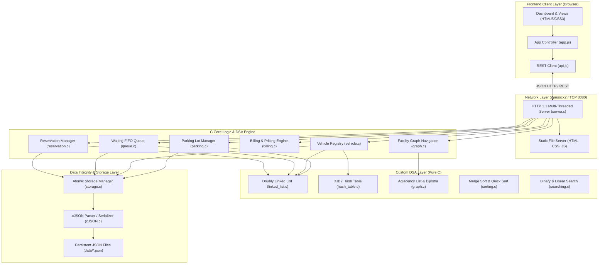

# System Architecture & Technical Specification
**Project:** Smart Parking Management System (College DSA Capstone)  
**Architecture:** Full-Stack Hybrid C/Web Architecture

---

## 1. System Architecture Overview

The Smart Parking Management System is built around a high-performance **native C Core Logic Engine** that exposes an embedded HTTP 1.1 REST API server. The modern web dashboard (HTML5, Vanilla CSS3, JavaScript) interacts with this backend using JSON requests over standard HTTP.

### Architecture Diagram

---

## 2. Request Flow Explanations

### 2.1 Vehicle Entry Workflow
1. Driver arrives at the entrance and submits registration plate and vehicle category.
2. `api.enterVehicle()` sends `POST /api/vehicles/entry`.
3. The C server validates plate format (alphanumeric, 3-12 characters).
4. **Hash Table Lookup:** Performs $O(1)$ search in `VehicleRegistry->active_hash` to guarantee vehicle is not already parked.
5. **Slot Allocation:** Checks `ParkingLot` for nearest available slot matching the requested category (`CAR`, `MOTORCYCLE`, `ACCESSIBLE`).
6. If no slot is available, prompts user for entry into the **FIFO Waiting Queue**.
7. If slot is available, slot state transitions to `OCCUPIED`.
8. Unique ticket ID (e.g. `TCK-20261010-1001`) is generated.
9. Vehicle record is inserted into `active_list` ($O(1)$) and pointer registered in `active_hash` ($O(1)$).
10. Atomic disk flush updates `data/slots.json` and `data/active_vehicles.json`.
11. Server returns HTTP 201 Created with JSON ticket details.

### 2.2 Vehicle Exit & Billing Workflow
1. Operator inputs registration plate or ticket ID.
2. `POST /api/vehicles/exit` with `confirm: false` retrieves active parking record.
3. System calculates duration in seconds: `duration = exit_time - entry_time`.
4. Pricing Engine applies category rates, grace period (15 mins free), minimum fee, and rounding increments (nearest 30 mins).
5. Breakdown displayed on frontend for driver confirmation.
6. Operator submits `confirm: true`:
   - Transaction appended to `data/history.json`.
   - Vehicle removed from `active_hash` and `active_list`.
   - Slot transitioned to `AVAILABLE`.
   - **Queue Promotion:** System queries `queue_dequeue_eligible()`. If an eligible vehicle is waiting in FIFO order, it is automatically assigned to the newly released slot!
   - Persistent files updated atomically.

---

## 3. Concurrency & Thread Synchronization

*   **Thread-Per-Request Model:** The HTTP server spawns client threads using native Windows `CreateThread` (or POSIX `pthread_create`).
*   **Critical Sections:** Parking slot state transitions and registry operations are synchronized using native `CRITICAL_SECTION` mutexes (`parking_lock` and `parking_unlock`), eliminating race conditions during simultaneous entry/exit requests.
*   **Safe File I/O:** Atomic temporary write strategy writes new data to `<filename>.tmp`, commits buffers to disk, and replaces the target file via `MoveFileEx(..., MOVEFILE_REPLACE_EXISTING)`.

---

## 4. Team of Four Integration Matrix

| Member | Primary Modules & Responsibilities | Interface Contract & Deliverables |
| :--- | :--- | :--- |
| **Member 1** | Parking Slot Management, Doubly Linked List, Category Allocation | `parking.h`, `parking.c`, `linked_list.h`, `linked_list.c` |
| **Member 2** | Waiting Queue, Registration Hash Table, Searching & Sorting | `queue.h`, `queue.c`, `hash_table.h`, `sorting.h`, `searching.h` |
| **Member 3** | C HTTP REST Server, File Persistence, Billing Engine, Graph Navigation | `server.h`, `server.c`, `storage.h`, `billing.h`, `graph.h` |
| **Member 4** | Web UI Dashboard, REST API Client, Automated Testing & Documentation | `frontend/`, `tests/`, `scripts/`, `README.md`, `docs/` |
